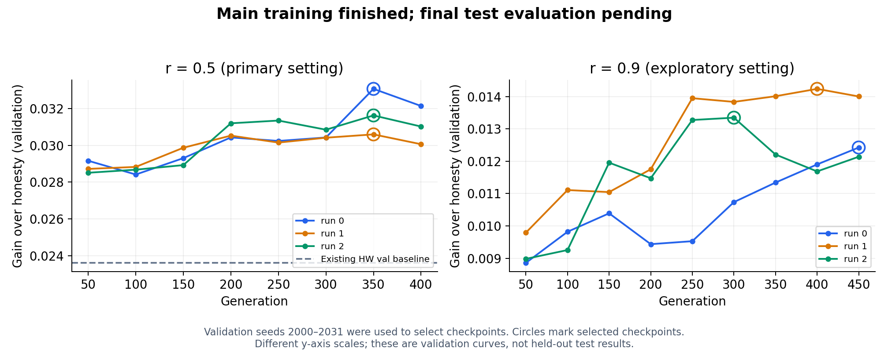

# 學校主實驗狀態與既有結果分析（2026-10-13）

> 此文是正式 test 前的歷史快照。後續已完成同步與正式評估，最新判定請看[主實驗結果](../results/main.md)。文中的「尚未完成」與「GitHub 未同步」描述查核當時狀態。

**訓練已完成，主實驗正式測試評估尚未完成。** 2026-10-13 透過 SSH 查核：GPU 沒有計算程序，主實驗 runner 沒有在跑。工作於 2026-10-10T23:54:09+08:00 開始、2026-10-11T22:29:33+08:00 完成最後一段，總經過約 22.59 小時；main_exit.log 於 2026-10-11 22:29:38 +08:00 記錄 EXIT 0。凍結計畫的 84 段全部有成功紀錄，六個 checkpoint 都完成預定世代，沒有提早停止。此次只用 CPU 讀取既有產物，沒有重新訓練、執行政策評估或開啟新的測試 seeds。

專案研究「多人競爭同一個稀缺服務時，如何處理自報需求的誇大」。早期工作包含環形空間中的移動服務與資訊價值；方向一改用抽象資源分配模型研究延遲稽核。這次學校工作是方向二的 M3C 主實驗：用 25 個公開資訊特徵、55 參數 MLP 與 sep-CMA-ES 學習報告策略，檢查它是否比 36 個既有手寫策略更能取得私利。防守方參數固定。r 表示真實狀態經過稽核延遲後的相關程度；r=0.5 是主格，r=0.9 依事前規格僅作探索性描述。

G 是偏離誠實報告後，每輪個人效用的增量；不是整個系統的效能提升，也不是百分比勝率。下表是訓練期間的驗證 seeds 2000–2031、T=100000、記分到 97500 的 G。每個 run 的 checkpoint 已依原定規則選定，不使用最後一代取代最佳驗證 checkpoint。

| 設定 | run | 完成世代 | 選定世代 | G_val | 相對既有手寫驗證基準的差 |
|---|---:|---:|---:|---:|---:|
| r=0.5 | 0 | 416 | 350 | 0.03306 | +0.00945 |
| r=0.5 | 1 | 416 | 350 | 0.03059 | +0.00698 |
| r=0.5 | 2 | 416 | 350 | 0.03162 | +0.00801 |
| r=0.9 | 0 | 499 | 450 | 0.01242 | 尚無同條件比較 |
| r=0.9 | 1 | 499 | 400 | 0.01424 | 尚無同條件比較 |
| r=0.9 | 2 | 499 | 300 | 0.01335 | 尚無同條件比較 |

r=0.5 的既有同條件手寫基準是 dz=0.3、G_val=0.02361289，取自 S1 事後 off-knob 診斷的基礎 M3C 環境。三個 run 的驗證差值為 +0.00698 至 +0.00945，方向一致，顯示學習策略有值得正式確認的優勢。這些 checkpoint 在同一組驗證 seeds 上選出，分數有選取偏差；三個正差值不等於三次正式顯著複現。r=0.9 三個 run 也學到正的驗證增益，但目前沒有同評估窗口、同 seeds、同手寫選取程序的比較，不拿方向一歷史 test 數字直接相減。該格的訓練排名雜訊在既定預算下已被登記為功效不足。

**新查核發現：main r=0.5 run0 與 S1 的 D2 s=0.02、s=0.01 是同一個學習結果。** 選定權重 SHA-256 完全相同（e8165c7441bc5678acee970be5cbd0013a36d173cd2c59e6e4207db728dd9b2f），完整的訓練均值曲線、族群最佳曲線、sigma 曲線與所有驗證紀錄也逐項相同。這與先前診斷「D2 parole 路徑沒有被用到」一致。因此 main run0 不能作為相對於 S1 的新增獨立複現；它仍是原登記三個主實驗 run 中的 run0，而 run1、run2 為不同權重。S1 已經評估過同一策略的 test 表現，後續主實驗報告應揭露這項先前暴露；此次沒有因此改選 run、checkpoint 或測試 seeds，也沒有把 S1 test 結果當作 main 正式結果。

同一權重先前在基礎 M3C 的 off-knob 診斷中，val2 上 D=+0.01234，95% CI [+0.00767, +0.01700]。這提供了既有的探索性旁證，但 val2 屬校準資料，不是主實驗測試集，也不能算另一個訓練 run。

S1 的限制仍須保留：原登記規則判為通過（族外 3/3），但利用漏洞的事後診斷只有 D1、O1 有證據（2/3）；D2 的優勢來自基礎 M3C 而非植入漏洞，O5 也沒有利用證據。主實驗目前的正向驗證結果，與「S1 的部分成功其實來自基礎機制上的優勢」相容，不會消除檢測力標定的混淆。

正式結果缺件已直接核對：學校 results/direction2/main.json 不存在，final_eval_ledger.json 的 32 筆全部屬 S1，沒有 main 項目。訓練 part 只有驗證均值，沒有主實驗逐 seed 測試 D、95% CI 或各 run 的完整 MDE。因此現在不能給 J3/J4 判定，也不能宣稱「正式證實 RL 擊敗手寫策略」。正式評估還需要依凍結規格選手寫基準、從 val 凍結每個 run 的 MDE、經 final_eval 的唯一入口評估全部三個 run，計算配對 D 與複現數，並報告 regret／誤罰率及 S1 限制。後續若查到新漏洞，還需要按原計畫以獨立環境查證。

**備份狀態：學校成果已取回本機，GitHub 仍未同步。** 實際 fetch 後 GitHub 停在 d57dfcb，學校為 e225845；GitHub 獨有 1 個提交、學校獨有 83 個提交。共同點後 GitHub 新增了啟動說明與 launcher 註解，學校接著產生訓練結果，造成非 fast-forward 推送被拒。GitHub 備份只成功到第一段；訓練沒有因此中斷。本次已將學校完整提交鏈抓到本機 refs/remotes/school/direction2-freeze，另取回結果快照與日誌，90 個 main 產物（84 part＋6 checkpoint）的 SHA-256 都與學校現存檔一致。沒有修改遠端分支或上傳新內容。

查核與數字可重算：`python3 .scratch/school-review-20261013/analyze.py`。機器可讀摘要與逐檔雜湊在 [main_review_20261013.json](../../../results/direction2/main_review_20261013.json)，原始快照在 `.scratch/school-review-20261013/snapshot/results/direction2/`，日誌在同層 `logs/`。摘要 runs[].source 指向學校原始 JSON 的相對路徑；表中 G、世代直接來自最終 part 的 best／gens_done，差值由 best.G_val 減去既有 off-knob 手寫驗證基準得到。此檔是狀態與驗證結果分析，不取代原定的主實驗正式報告。
