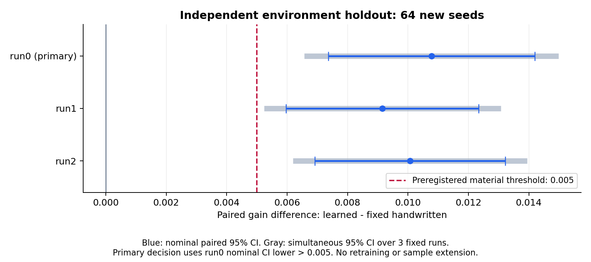

# 獨立環境 holdout 結果

本批結論：**確認實質優勢**。固定主 run0 的 D=+0.010778 [+0.007362, +0.014194]；事前實質門檻 δ=0.005，判準為配對 95% CI 下界>δ。三個既有 run 中 3/3 的 Bonferroni 同時 95% CI 下界>0。

本批全部在學校執行，模型、機制及手寫基準先凍結；64 個新環境 seeds 不參與訓練、選模或除錯。主設定 r=0.5，T=100000、T_score=97500；G 是相對誠實報告的每輪個人效用增量，D 是學習策略相對固定手寫 dz=0.3 的差。

| run | G [名目 95% CI] | D [名目 95% CI] | D [三個 run 同時 95% CI] |
|---|---|---|---|
| 0（固定主值） | +0.032886 [+0.029539, +0.036233] | +0.010778 [+0.007362, +0.014194] | +0.010778 [+0.006573, +0.014983] |
| 1 | +0.031266 [+0.027895, +0.034636] | +0.009158 [+0.005970, +0.012345] | +0.009158 [+0.005235, +0.013080] |
| 2 | +0.032176 [+0.028643, +0.035709] | +0.010068 [+0.006918, +0.013218] | +0.010068 [+0.006191, +0.013945] |

手寫基準 G=+0.022108 [+0.018804, +0.025412]。每個 CI 的樣本單位是 64 個環境 seeds；三個 run 共用環境亂數，沒有合併成 192 個獨立樣本。次要同時區間描述固定 checkpoints 的一致性，不影響主判定。

## 系統代價（描述性）

| 政策 | regret／輪 [95% CI] | agent 0 不合格比例 | agent 1 不合格比例 | agent 2 不合格比例 |
|---|---|---:|---:|---:|
| honest | +0.008446 [+0.007277, +0.009616] | 0.03360 | 0.02124 | 0.04657 |
| handwritten | +0.017687 [+0.016375, +0.019000] | 0.03437 | 0.14267 | 0.04639 |
| run0 | +0.020544 [+0.019436, +0.021651] | 0.02596 | 0.13487 | 0.04359 |
| run1 | +0.019716 [+0.018440, +0.020992] | 0.02640 | 0.13621 | 0.04118 |
| run2 | +0.020182 [+0.018872, +0.021492] | 0.02520 | 0.13760 | 0.04158 |

上表只作系統結果的描述，沒有新增 regret 或不合格比例的顯著性主張。攻擊者增加私利不能解讀為系統整體改善。

## 規劃、執行與停止

協定與 manifest 在首次 holdout 執行前提交（`436424b`）。掃描 452 份原有 JSON／NPZ 的 seed 欄位，新三流共 192 個 generator seeds 與已保存 seed 值及其 offsets 無交集。此查核限本專案保存紀錄，無法證明外部未留紀錄的執行不存在。

原規劃的 95% CI 半寬為 0.002352，實際主值半寬為 0.003416。新資料變異高於規劃假設；沒有依此追加樣本或調整門檻。RL 批次 47.6 秒、手寫批次 200.5 秒；各執行一次，沒有中途更換模型、加 seeds 或重跑挑結果。7 項 CPU 與 1 項 GPU 驗收通過，獨立 CPU 稽核完成 150 項數值核對。原正式 test ledger 仍為 42 筆；本批另有兩批次 ledger。

固定樣本量已完成，這輪確認實驗到此停止。結論針對已固定的策略與機制；未再訓練，因此不估計新訓練的成功率。它補上新環境資料的確認，保留原 test 暴露與 S1 標定混淆的揭露，不能用來宣稱已找到最強攻擊或勝過所有手寫方法。

資料：[manifest](../../../results/direction2/holdout/manifest.json)、[逐 seed 結果](../../../results/direction2/holdout/result.json)、[獨立稽核](../../../results/direction2/holdout/audit.json)、[執行紀錄](../../../results/direction2/holdout/execution.json)、[原始快照／ledger](../../../results/direction2/holdout/)。

[執行前協定](../design/independent-holdout.md) · [本階段結論](conclusion.md) · [原正式 test](main.md) · [事後診斷](postmain-diagnostics.md)。重建：`.venv/bin/python scripts/report_d2_holdout.py`（CPU；已保存執行紀錄，可直接從快照重算）。
