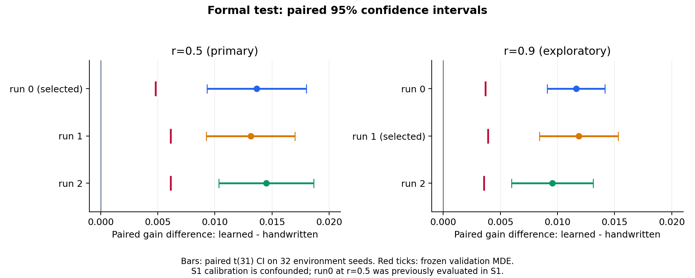

# 方向二主實驗：正式 test、配對信賴區間與複現判定

依原登記規則，主要設定 r=0.5 判為 **J3：(i) 找到（完全複現）**。validation 選定 run0；D=+0.01366 [+0.00932, +0.01800]，MDE_D=0.00481，三個 run 中 3/3 的配對 D 信賴區間下界大於 0。

此判定必須連同 S1 限制閱讀：原登記閘門通過，但事後 off-knob 診斷只有 2/3 族外漏洞有利用證據；D2、O5 的 detected 混入基礎優勢。因此結果支持此固定機制與策略類別下的數值比較，不能把 S1 解讀成對任意漏洞的可靠檢測力保證。

兩個 cell 各三個 run 全部報告；每個 checkpoint 與主 run 都在 validation 選定。test 使用原定 32 個 seeds，T=100000、記分到 T−L=97500。G 是相對同 seed 誠實報告的每輪個人效用增量；D 是 RL 與 validation 選定手寫基準的逐 seed 差。下列 95% CI 使用 paired t(31)，沒有把三個 run 合併成 96 個獨立樣本。

| r | run | 選定世代 | G_RL [95% CI] | D [95% CI] | MDE_D | D 規則 |
|---|---:|---:|---|---|---:|---|
| 0.5 | 0（主值） | 350 | +0.03452 [+0.02997, +0.03908] | +0.01366 [+0.00932, +0.01800] | 0.00481 | 通過 |
| 0.5 | 1 | 350 | +0.03399 [+0.02984, +0.03814] | +0.01313 [+0.00925, +0.01700] | 0.00613 | 通過 |
| 0.5 | 2 | 350 | +0.03537 [+0.03139, +0.03934] | +0.01450 [+0.01034, +0.01865] | 0.00613 | 通過 |
| 0.9 | 0 | 450 | +0.01296 [+0.01095, +0.01497] | +0.01163 [+0.00911, +0.01415] | 0.00368 | 通過 |
| 0.9 | 1（主值） | 400 | +0.01318 [+0.01011, +0.01626] | +0.01185 [+0.00841, +0.01530] | 0.00390 | 通過 |
| 0.9 | 2 | 300 | +0.01087 [+0.00776, +0.01398] | +0.00954 [+0.00596, +0.01311] | 0.00355 | 通過 |

| r | validation 選定手寫基準 | G_HW [95% CI] | 含 H0 選定者 | 含 oracle 選定者及 G |
|---|---|---|---|---|
| 0.5 | dz=0.3 | +0.02087 [+0.01679, +0.02495] | dz=0.3 | edge_oracle em=0.2：+0.08646 [+0.08097, +0.09195] |
| 0.9 | dz=0.01 | +0.00133 [+0.00027, +0.00239] | dz=0.01 | edge_oracle em=0.05：+0.02111 [+0.01756, +0.02467] |

含 H0 的附帶判定為 J3；不改變主要判定。複現數依規格計 D_lo>0，與每個 run 是否同時跨過自己的 MDE 是兩件事。r=0.9 是探索性、未經 S1 標定，而且事前量測顯示既定訓練預算下功效不足，不用來決定主要 J 列。

這些正差值表示：只看公開資訊的學習策略，在固定 M3C 上找到了手寫候選沒有捕捉到的額外私利。表中的 oracle 策略有額外資訊，不屬公平的主要對照；其更高的 G 也提醒我們，當前搜尋沒有證明已找到最強攻擊。

系統層面的代價如下。honest α 是三位 agent 平均的不合格比例；攻擊下另外列出仍誠實的 agent 0、2 被暫停的比例。這些數字均來自同一 T_score 快照。

| r | 策略 | R/T [95% CI] | honest α 或 agent 0、2 暫停比例 |
|---|---|---|---|
| 0.5 | 全體誠實 | +0.00686 [+0.00506, +0.00866] | α=+0.02776 [+0.02143, +0.03408] |
| 0.5 | 手寫 dz=0.3 | +0.01534 [+0.01325, +0.01743] | agent0=0.02418；agent2=0.03300 |
| 0.5 | RL run0 | +0.01957 [+0.01794, +0.02121] | agent0=0.02393；agent2=0.03702 |
| 0.5 | RL run1 | +0.01942 [+0.01746, +0.02139] | agent0=0.02714；agent2=0.03919 |
| 0.5 | RL run2 | +0.01988 [+0.01807, +0.02169] | agent0=0.02634；agent2=0.03781 |
| 0.9 | 全體誠實 | +0.00702 [+0.00529, +0.00876] | α=+0.03039 [+0.02404, +0.03674] |
| 0.9 | 手寫 dz=0.01 | +0.00713 [+0.00536, +0.00891] | agent0=0.02331；agent2=0.03866 |
| 0.9 | RL run0 | +0.00928 [+0.00743, +0.01113] | agent0=0.02170；agent2=0.04106 |
| 0.9 | RL run1 | +0.00934 [+0.00749, +0.01119] | agent0=0.02010；agent2=0.03705 |
| 0.9 | RL run2 | +0.01031 [+0.00834, +0.01227] | agent0=0.02010；agent2=0.04026 |

以主要設定為例，誠實時平均 R/T=0.00686，run0 攻擊下為 0.01957。攻擊者的個人增益伴隨較高的系統 regret，不能解讀成整體系統效能提升。這裡列出均值比較，未另作 regret 差值的顯著性判定。

**先前 test 暴露與證據獨立性。** r=0.5 run0 與 S1 的 D2 兩格權重、訓練曲線完全相同。S1 已在同一組 test seeds 評估過該策略；因此本次 main run0 不能算相對於 S1 的新增獨立證據。其餘兩個 run 是原定的不同訓練 seed。此次保留全部原定 run、checkpoint、手寫候選與 test seeds，沒有依 test 分數更換主 run。完整政策雜湊對照在 main.json 的 prior_identical_policies。

數值只針對固定 M3C 參數與公開資訊 MLP（25 特徵、55 參數）；機制沒有針對 RL 重新調參。信賴區間反映給定政策下的環境 seed 變異，不涵蓋重新訓練的所有不確定性。這不是最佳回應的證明，也不直接代表真實機器人系統。

依凍結規格附上 S1 描述（原 detected 定義）：6 個類內漏洞中 RL 找回 3 個；其中族外 3 個找回 3 個（s=0.02；族外在 s=0.01 找回 3/3；固定預算：T_train=20000、λ=256、n_S=256、G_gens=416，各 1 個 run；MDE_D=族外六格 0.00481 至 0.00740）。6 個類內漏洞＝族外 3 個（D1、D2、O1）＋族內 3 個（O2、O3、D4）；族內漏洞手寫細網格（S_HW 36 個）已能取得大部分得利，只作描述，不計入通過判定。族內已知的 D3 單獨報告、不計入。對單一盲區範例（O5）的描述：原規則 detected=True，D=+0.01024 [+0.00609, +0.01439]；但 off-knob 診斷沒有利用證據，屬基礎優勢混淆（預期不被找到）；本套件沒有 B1／B2（絕對時間、長記憶）的證據，不得由 O5 的結果推論對這類盲區的偵測能力。此為對本套件的描述，不外推到其他漏洞，也不推論其他漏洞被找回的比例。

上述「找回」是原規則的計數；事後利用證據僅族外 2/3。D2 為偽陽性，O5 亦未證實利用，不可把此計數當成對未知漏洞的檢測率。S1 的 O1 與 NAIVE／M4 錨點也曾在正式 S1 入口前的煙霧測試暴露 test seeds，完整時間線保留於 [S1 報告](s1.md)。

固定 M3C 配置為 p=0.1、h=6、L=2500、kref=0.5。公開特徵是手工充分統計量的近似，未涵蓋的長歷史或絕對時間模式仍可能形成漏掉的漏洞。

【揭露清單】【D1 混合參考策略】D1 的參考策略是「字面策略＋固定灌水 dz0」的混合，混合是為了湊足登錄大小（commander 已接受，meta 已標示）。【honest_drift 漂移】漏洞環境中誠實（θ=0）的得利與基礎環境不同（逐項漂移量：D1:+0.0001/D2:+0.0000/D4:+0.0009）；此漂移不影響同一環境內配對的 G 與 Δ，但須逐項記錄。【D4 knob 不單調】D4 的 Δ 對 knob 不單調，校準以掃描完成（knob_monotone=false）。【倖存者偏誤】套件只保留 Δ>0 且可校準的漏洞：D3 的 Δ 為負而單獨報告、O4（最高約 0.0027）與 O6（最高約 0.0036）校準不到 0.01 而移出、B1／B2 未實作；因此套件不代表所有可能的漏洞。【designer_1 受汙染】designer_1 的材料含特徵細節，不計入任何統計（REQ-S1-23）。【盲區】本套件只有一個盲區範例（O5），沒有 B1／B2（絕對時間、長記憶）的證據；盲區結果只能寫成對單一盲區範例（O5）的描述。【細網格】手寫基準 S_HW 擴為 36 個（REQ-HW-06）使手寫族更強，「RL 對手寫最佳」的比較對 RL 較為保守；族內三者（O2、O3、D4）因細網格已被手寫族涵蓋而只描述。【val2】knob 以 val∪val2 合併選擇（贏家詛咒的對策）；val2（3000–3031）不是測試集，不出現在任何測試結果中。【n_S 涵蓋】n_S=256 只涵蓋三種 σ 的中位數最壞情況；單一隨機對的最壞情況需 n_S≈565，目前無法涵蓋（REQ-OPT-13）。【burst 時鐘】手寫的 burst 策略使用代理人自己的回合時鐘，而 RL 的觀察不含時間，因此 RL 對手寫策略的比較對 RL 較為保守（REQ-HW-05）。

所有評估在學校機器以原有 float64 模擬器執行；MLP 使用已驗證一致的 CUDA Graph，手寫策略使用 eager。原始逐 seed 快照、validation 選取與凍結 MDE、test ledger 都有保存。本報告另以獨立 scipy 計算核對 112 項 CI／MDE，全部一致。

資料：[main.json](../../../results/direction2/main.json)、[逐 seed 與選取紀錄](../../../results/direction2/main_eval/)、[機器可讀稽核](../../../results/direction2/main_audit.json)、[數字來源表](number-audit.md)。重建：`python3 scripts/report_d2_main.py`（CPU，不重新評估政策）。
相關：[正式評估協定](../design/main-evaluation.md)、[S1 結果](s1.md)、[凍結規格](../../direction2-spec.md)。

後續已完成 [截斷偏差、特徵消融與公開行為診斷](postmain-diagnostics.md)。這批只用 validation，屬主實驗後的探索性分析；不校正此處 test 數字，也不新增獨立複現證據。
