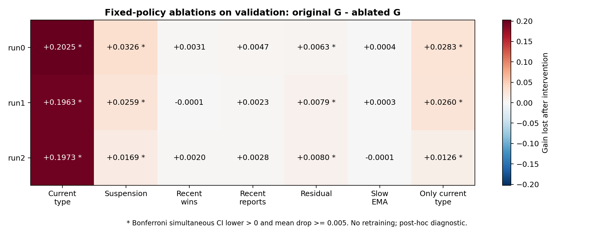
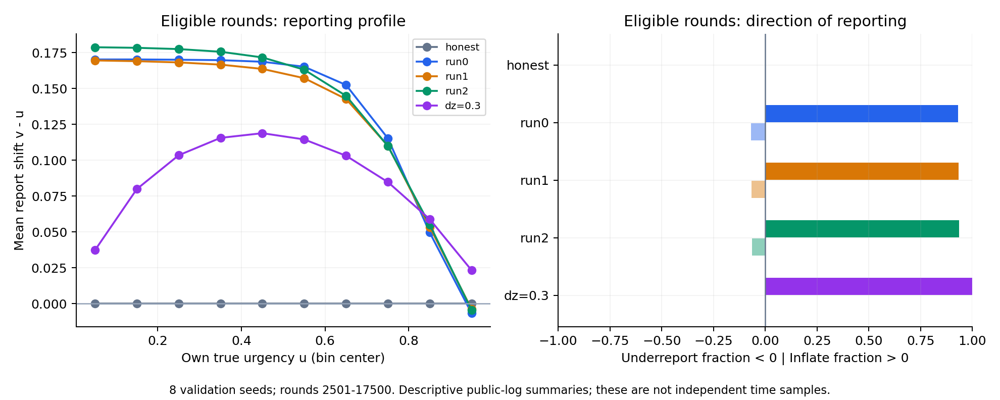

# 主實驗後診斷：截斷偏差、消融與報告行為

本批在學校完成；使用已固定的 checkpoint、機制與手寫基準，沒有再訓練。全部資料來自 validation，且假說是在看過正式主實驗後提出，所以屬事後探索性診斷，不是新 holdout；不修改正式 test、ledger 或 J3。

## 1. 尾端強制誠實的影響

正常值取自已保存 validation 快照；變體只在 t>95000 強制誠實，記分至 97500。ΔG=G_normal−G_variant，CI 以 32 個環境 seeds 的配對差計算。

| r | 政策 | 正常 G | 變體 G | ΔG [95% CI] | 凍結 G-MDE | 下界／均值門檻 |
|---|---|---:|---:|---|---:|---|
| 0.5 | run0 | 0.033065 | 0.031792 | +0.001272 [+0.001040, +0.001505] | 0.006081 | 未過／未過 |
| 0.5 | dz=0.3 | 0.023613 | 0.022666 | +0.000947 [+0.000573, +0.001321] | 0.006261 | 未過／未過 |
| 0.9 | run1 | 0.014239 | 0.013820 | +0.000419 [+0.000330, +0.000508] | 0.004063 | 未過／未過 |
| 0.9 | dz=0.01 | 0.001978 | 0.001932 | +0.000046 [+0.000039, +0.000053] | 0.000809 | 未過／未過 |

下界門檻為 CI_lo>0 且 CI_lo≥既有 G-MDE；較寬的均值門檻為 CI_lo>0 且 mean≥同一 MDE。MDE 沿用該政策的凍結值，不是這次 ΔG 的重新功效估計。兩個判準完整列出。

| r | 正常 D [95% CI] | 尾端誠實 D [95% CI] | ΔD [95% CI] |
|---|---|---|---|
| 0.5 | +0.009452 [+0.006056, +0.012847] | +0.009126 [+0.005812, +0.012440] | +0.000325 [-0.000089, +0.000740] |
| 0.9 | +0.012261 [+0.009512, +0.015010] | +0.011888 [+0.009162, +0.014614] | +0.000373 [+0.000284, +0.000462] |

四項均未觸發原規格字面門檻。這不代表偏差為零；應同時看上表的 ΔG 量級與區間。

主要設定 r=0.5 的 D 從 0.009452 變為 0.009126，變化量為 +0.000325 [-0.000089, +0.000740]。尾端誠實後的 D 區間仍高於零，因此在本組 validation 上，這個尾端干預沒有消除學習策略的優勢。

此量測同時移除了尾端攻擊收益與後續效果，只是規格指定的截斷偏差近似，不能精確等同「未收取的未來罰款」。ΔD 表示該干預對 RL 與手寫差距的影響，不回填或校正正式 test。

## 2. 固定策略的特徵依賴

每次把一組輸入的第一層權重設為零，其餘不變，不重訓。drop=G_original−G_ablation；正值代表原策略移除該組後變差。所有 21 個 drop 使用 Bonferroni 同時 95% 區間；下界>0 且均值≥0.005 才標為『實質依賴』。

| run | 移除組別／變體 | G_ablation | D_ablation [名目 95% CI] | drop [同時 95% CI] | 實質依賴 |
|---|---|---:|---|---|---|
| 0 | 當前型別 | -0.169403 | -0.193016 [-0.197605, -0.188427] | +0.202468 [+0.194964, +0.209972] | 是 |
| 0 | 暫停／資格 | +0.000448 | -0.023165 [-0.028046, -0.018283] | +0.032617 [+0.025234, +0.039999] | 是 |
| 0 | 近期得標 | +0.029985 | +0.006372 [+0.002195, +0.010548] | +0.003080 [-0.002389, +0.008549] | 否 |
| 0 | 近期報告偏移 | +0.028398 | +0.004786 [+0.001735, +0.007836] | +0.004666 [+0.000021, +0.009311] | 否 |
| 0 | 殘差 | +0.026777 | +0.003164 [-0.001090, +0.007418] | +0.006287 [+0.001072, +0.011502] | 是 |
| 0 | 慢速 EMA | +0.032660 | +0.009047 [+0.005640, +0.012453] | +0.000405 [-0.002630, +0.003440] | 否 |
| 0 | 只保留當前型別 | +0.004799 | -0.018814 [-0.023653, -0.013975] | +0.028266 [+0.020803, +0.035728] | 是 |
| 1 | 當前型別 | -0.165745 | -0.189357 [-0.193894, -0.184821] | +0.196336 [+0.188466, +0.204206] | 是 |
| 1 | 暫停／資格 | +0.004684 | -0.018929 [-0.023624, -0.014235] | +0.025908 [+0.018698, +0.033117] | 是 |
| 1 | 近期得標 | +0.030669 | +0.007056 [+0.002134, +0.011978] | -0.000078 [-0.004198, +0.004043] | 否 |
| 1 | 近期報告偏移 | +0.028260 | +0.004647 [+0.000069, +0.009224] | +0.002332 [-0.002104, +0.006768] | 否 |
| 1 | 殘差 | +0.022648 | -0.000965 [-0.005923, +0.003993] | +0.007944 [+0.001286, +0.014601] | 是 |
| 1 | 慢速 EMA | +0.030292 | +0.006679 [+0.002609, +0.010750] | +0.000299 [-0.001988, +0.002586] | 否 |
| 1 | 只保留當前型別 | +0.004632 | -0.018981 [-0.023965, -0.013998] | +0.025960 [+0.018765, +0.033155] | 是 |
| 2 | 當前型別 | -0.165643 | -0.189255 [-0.194203, -0.184308] | +0.197264 [+0.189145, +0.205382] | 是 |
| 2 | 暫停／資格 | +0.014687 | -0.008926 [-0.013403, -0.004450] | +0.016934 [+0.010013, +0.023855] | 是 |
| 2 | 近期得標 | +0.029605 | +0.005992 [+0.001703, +0.010281] | +0.002016 [-0.002866, +0.006898] | 否 |
| 2 | 近期報告偏移 | +0.028794 | +0.005181 [+0.000994, +0.009368] | +0.002827 [-0.003706, +0.009360] | 否 |
| 2 | 殘差 | +0.023578 | -0.000035 [-0.004307, +0.004236] | +0.008043 [+0.000858, +0.015229] | 是 |
| 2 | 慢速 EMA | +0.031738 | +0.008125 [+0.003807, +0.012443] | -0.000117 [-0.002916, +0.002681] | 否 |
| 2 | 只保留當前型別 | +0.019039 | -0.004573 [-0.009111, -0.000036] | +0.012582 [+0.006261, +0.018903] | 是 |

三個 run 都達到實質依賴判準的干預：當前型別、暫停／資格、殘差、只保留當前型別。

較有解釋力的是歷史狀態：移除暫停／資格資訊，三個 run 的 G 下降 0.0169–0.0326；移除殘差資訊則下降 0.0063–0.0080。只保留當前型別時，三個 run 的 D 名目區間皆低於零；這些固定策略在此干預下都輸給手寫基準。當前型別被移除時跌幅最大，但這也是很強的分布外干預，不能把跌幅當成各特徵的通用重要性排序。

這是在既有 checkpoint 中的功能依賴，不代表該資訊對任何可能策略都必要；零值干預可能離開訓練分布，各組有冗餘及非線性交互作用，drop 不能相加。未過門檻也不能宣稱該特徵無用。多重比較校正不消除 checkpoint 在同組 validation 選取的偏差。D 欄只有名目區間，不能當成新的正式發現。

## 3. 原策略如何報告

公開軌跡：每政策 8 個 validation seeds、20000 輪；以下取第 2501–17500 輪。數字描述觀察到的分布，不將每個時間點當獨立樣本。公開觀察全程可逐位元從公開日誌重建。

| 策略 | 符合資格時平均 v−u | 誇大比例 | 縮小比例 | 暫停時平均 v−u |
|---|---:|---:|---:|---:|
| honest | +0.00000 | 0.0% | 0.0% | 無樣本 |
| run0 | +0.13238 | 93.1% | 6.9% | +0.04600 |
| run1 | +0.12960 | 93.4% | 6.6% | +0.06617 |
| run2 | +0.13488 | 93.6% | 6.4% | +0.10114 |
| dz=0.3 | +0.08391 | 100.0% | 0.0% | +0.08400 |

誇大／縮小用 |v−u|>1e−6 區分。資格、上一輪得標與型別區間的完整逐 seed 摘要均已保存。分組差異可能受型別分布及策略造成的歷史差異影響，單看曲線不能證明因果。

| run | u<0.1 的平均 v−u | u≥0.9 的平均 v−u | u≥0.9 各 seed 均值範圍 | 上一輪得標／未得標後的平均 v−u |
|---|---:|---:|---|---|
| run0 | +0.17030 | -0.00670 | [-0.00864, -0.00584] | +0.10612／+0.14623 |
| run1 | +0.16962 | -0.00380 | [-0.00560, -0.00237] | +0.10569／+0.14203 |
| run2 | +0.17883 | -0.00447 | [-0.00528, -0.00374] | +0.11010／+0.14799 |

三個 run 的形狀接近：低急迫度時加得較多，高急迫度時收斂，在最高區間平均略微低報；後者在本批每個 seed 都同方向，但這裡沒有另作確認性檢定。上一輪得標後平均誇大較少，仍可能混有型別分布差異。綜合消融，較受支持的假說是：策略依當期型別決定基本偏移，再用暫停狀態與殘差調整報告。目前尚未拆解到各項調整如何產生淨收益，也沒有證明它重建了私有稽核分數。

固定權重也可作純代數檢查。對輸出偏移 d=tanh(W2·h+b2)，∂d/∂x_i=(1−d²)Σ_j W2_j·(1−h_j²)·W1_ij。若兩個隱單元的 W2_j·W1_ij 同號，該輸入座標對 d 的方向在其他輸入固定時不會翻轉。以下直接由原 checkpoint 推得，不是新增模擬或顯著性檢定。

| 輸入增加（其餘座標固定） | run0 的 d | run1 的 d | run2 的 d |
|---|---|---|---|
| 服務資格 0→1 | 不減 | 不減 | 不減 |
| 距上次暫停通知時間 | 不減 | 不減 | 不減 |
| 上一輪 v−u | 不增 | 不增 | 不增 |
| 上一輪得標後的殘差特徵 | 不增 | 不增 | 不增 |
| 得標的慢速 EMA | 不減 | 不減 | 不減 |
| 當前 u 特徵（固定 z） | 不增 | 不增 | 不增 |

這些方向描述的是 d，實際報告還有 v=clip(u+d)。輸入彼此會相關（尤其 z 與 u），固定其他座標不是實際環境一定會發生的情況；不能由此直接推論防守參數調整後的因果效果。全特徵係數與方向見 [policy_structure](../../../results/direction2/postmain_policy_structure.json)。

## 4. 邊界與驗證

S1 的基礎優勢混淆與主 run0 的先前 test 暴露仍然存在，本批不能修復這些限制。本批也未執行全新 holdout 或 E1 防守方學習；下一個確認性實驗須另行登記。

診斷前 5 項 CPU、1 項 GPU 驗收通過；GPU 驗收涵蓋遮罩 graph/eager、尾端干預邊界、記錄開關與公開觀察重建。本報告另從快照與公開軌跡完成 1748 項數值核對。首次驗收抓到權重 view 的原地修改，在任何診斷量測前修正為複製權重，原 checkpoint 不變。第一個尾端變體曾因既有 ad_h=Infinity 的 JSON 設定資訊序列化失敗，該次沒有保存結果；改為只在設定資訊中明確編碼無限值、保留原模擬參數後，重跑 validation 變體。

資料：[截斷偏差](../../../results/direction2/trunc_bias.json)、[消融](../../../results/direction2/postmain_ablation.json)、[行為](../../../results/direction2/postmain_behavior.json)、[數字稽核](../../../results/direction2/postmain_audit.json)、[交付驗證](../../../results/direction2/postmain_validation.json)、[原始快照與軌跡](../../../results/direction2/postmain/)。

[執行前診斷協定](../design/postmain-diagnostics.md) · [正式主實驗結果](main.md)。重建報告：`.venv/bin/python scripts/report_d2_postmain.py`（CPU）。
